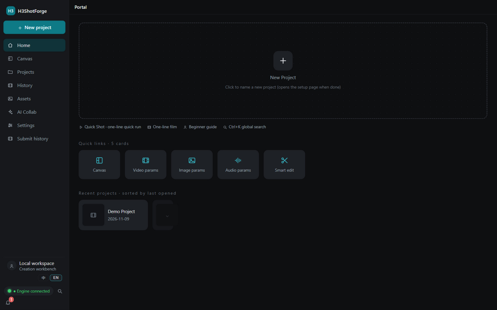
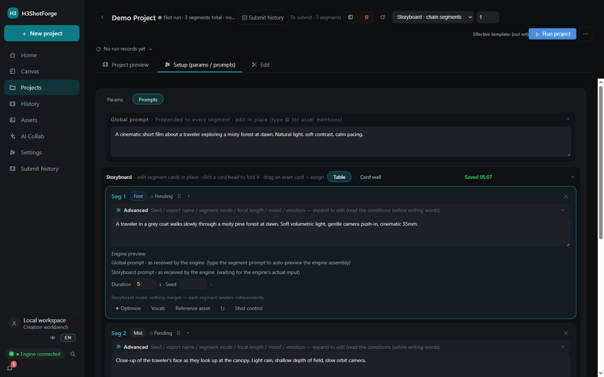
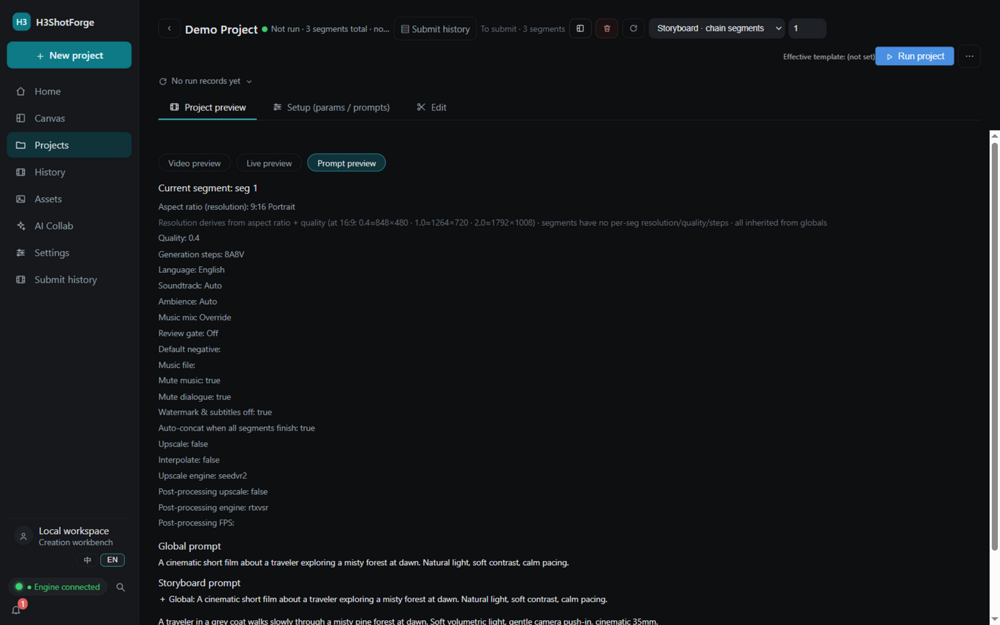
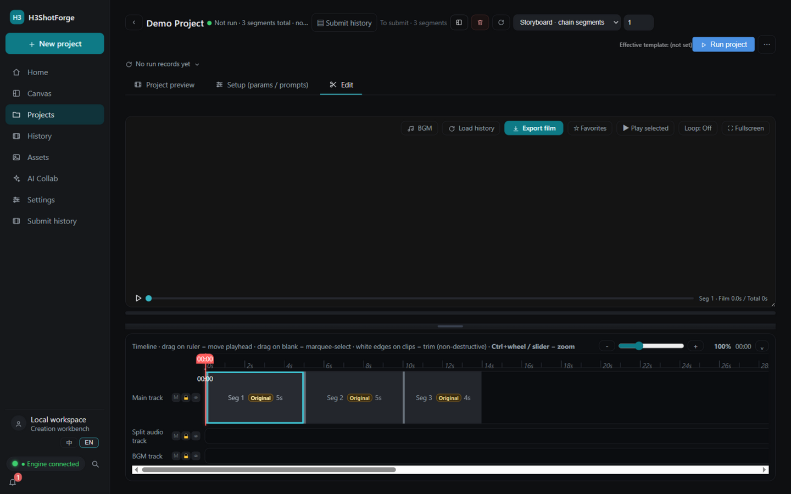

# H3ShotForge · GUI1.4

> A local-first AI storyboard & shot studio — web GUI + ComfyUI plugin, used as a pair.
>
> [中文](README.md) | **English**

H3ShotForge connects the whole loop: write a storyboard → attach references → submit renders → watch the film → edit on a timeline. The front end is a plain static web app (vanilla HTML/CSS/JS, no framework); the back end is a small Python dev server; generation is provided by the `ComfyUI-H3ShotForge` custom node. All project data stays on your machine.

## Highlights

- **Long videos on 12GB VRAM**: Concat mode merges multiple 5-second segments into one long film; measured on a 12GB GPU at 16:9 / 0.4MP / 5s per segment, producing a 5–6 minute film (varies with model and template).
- **Storyboard mode**: one shot per segment, write prompts segment by segment; per-segment duration, seed and camera fields.
- **One-click three-view assets**: turn a reference image into three-view / multi-angle cards; manage characters, scenes and props; drag into a segment to auto-reference with `@N`.
- **Per-segment redo**: re-run any single segment you are unhappy with (new seed / same seed / changed params / multiple candidates) without touching the others; failed segments can be handled with “Re-render failed only”.
- **Resume after interruption**: “Resume unfinished” continues from segment K after a multi-segment task stops — completed segments are kept, no need to start over.
- **Multimodal references**: attach images, video and audio to a segment; they are injected into the prompt automatically (`<Picture N>` / `<Video N>` / `<Audio N>`).
- **AI storyboard assistant**: turn one sentence into multiple segments, rewrite prompts segment by segment, adopt results with one click (works with a local LLM).
- **Audio continuity**: per-segment reference audio (voice lock) + split-track inheritance (vocals / background) + BGM, optional.
- **Local-first**: project data, generation and LLM can all stay on your machine; local JSON data — copy to back up or migrate.
- **Post-processing built in**: SeedVR2 / RTX VSR upscale, RIFE interpolation, concat and color matching.
- **ComfyUI ecosystem**: built on the official MiniMax H3 nodes; workflow templates are replaceable and not locked to one model.
- **Bilingual UI**: one-click toggle, Chinese by default, remembered per browser.

## Three project modes

| Mode | Best for | Behavior |
|---|---|---|
| **Storyboard** | Narrative / multi-shot | Each segment renders independently, no merge (good for chaining) |
| **Concat** | Long videos | All segments are merged into one long film; small segments → long video, low-VRAM friendly |
| **Custom** | Mixed | Choose which segments join the merge (others stay separate) |

## Screenshots

| Home | Canvas |
|---|---|
|  |  |

| Storyboard & prompts | Prompt preview |
|---|---|
|  |  |

> Screenshots use a demo project and the English UI; no real user data is included.

### Timeline editing



## Features

- **Projects**: create / open / import / recycle bin; recent projects sorted by last opened.
- **Storyboard & prompts**: edit segment cards in place; per-segment duration, seed, camera fields (angle / shot size / movement / focal length / mood / emotion) and reference images.
- **Asset library**: character / scene / prop cards with **one-click three-view / multi-angle generation** and reference audio; drag into a segment to auto-reference with `@N`.
- **Canvas**: wire global params, segments, assets and processing nodes into a graph; pan, zoom, undo / redo.
- **AI collaboration**: optional OpenAI-compatible LLM for rewriting, shot splitting and adopting results back into the storyboard.
- **Submit & render**: preflight → ComfyUI batch → progress / stop / **resume from segment K**; **per-segment redo / re-render failed only**; multi-segment merge, upscale and interpolation (long films can be auto-segmented by the post-processing threshold).
- **Preview & edit**: full-film preview; timeline split / speed / transitions / version compare / multi-candidates / audio separation / copy-paste and reorder / undo-redo; BGM and clip volume, fade in/out; upscale and interpolation.
- **History & run records**: inspect outputs per task, rerun, copy as a new project, load parameter snapshots.
- **Bilingual UI**: switch with the `中｜EN` control at the bottom-left (or in Settings); Chinese by default, remembered per browser.

## Structure

```
GUI1.4/                            Web front end + dev server (this repo)
引擎端/V1.14/ComfyUI-H3ShotForge/  ComfyUI custom node (this repo)
```

- **GUI**: `app/` (static pages) + `scripts/devserver.py` (Python standard-library HTTP server for static files, data I/O and engine proxying).
- **Engine**: ComfyUI plugin providing batch rendering, prompt assembly, concat / color matching / post-processing and LLM sessions; it runs inside ComfyUI (no separate port — ComfyUI defaults to `8188`, use your actual address).
- The two talk over HTTP. The GUI can browse and edit existing projects offline, but **rendering requires the engine**.

## Requirements

| Item | Requirement |
|---|---|
| OS | Windows 10 / 11 (primary tested environment; Linux / macOS untested) |
| Python | 3.10+ (tested on 3.11) |
| ComfyUI | Must include the official MiniMax H3 nodes (core v0.30.0+; use the latest desktop build); H3 models and workflow templates are not bundled |
| ffmpeg / ffprobe | Needed for concat, color matching, post-processing and audio tracks; if not on PATH, set `ffprobe_exe` in `h3_config.json` |
| H3 models & workflow templates | **Not bundled**; install them in ComfyUI and point `workflow_dir` at your templates |
| LLM (optional) | AI collaboration needs an OpenAI-compatible endpoint (LM Studio or a hosted API) |

## Supported workflows

The engine identifies template families by **structure + file name**:

| Family | Supported | Notes |
|---|---|---|
| **ref2v** | ✅ recommended | Template contains `MiniMaxH3ReferenceToVideo`; supports reference images / video / audio (`<Picture N>` / `<Video N>` / `<Audio N>`), optional Turbo LoRA. Example: `turboVA+CK/h3_ref2va_8V8A_CK.json` |
| **t2v** | ✅ | Text-only generation (anonymous workflow / no H3 reference node), for shots without references |
| i2v / fl2v | ❌ retired | The engine rejects them: “i2v/fl2v 已废除，请改用 ref2v 模板” |

- **Location**: `workflow_dir` in `h3_config.json`; the engine scans every `.json` recursively (skipping directories whose name contains “备份”), and the GUI template dropdown reads from it.
- **Template requirements**: a native ComfyUI H3 workflow (ref2v templates use the official `MiniMaxH3ReferenceToVideo` with `MiniMaxH3SigmaShift`, `BasicScheduler` / `KSamplerSelect` / `BasicGuider` and the audio/video decode chain), saved as JSON; the engine rewrites prompt, seed, duration and reference inputs. `MiniMaxH3ImageToVideo` i2v/fl2v templates are rejected (retired).
- **Templates are not bundled**: provide your own (see Downloads).

## Post-processing (upscale / interpolation)

| Capability | Engine option | Template | Node pack / source |
|---|---|---|---|
| Upscale | SeedVR2 (default) | `h3_postfx_upscale.json` (bundled) | [ComfyUI-SeedVR2_VideoUpscaler](https://github.com/numz/ComfyUI-SeedVR2_VideoUpscaler) (official SeedVR2 ComfyUI release; models per its README) |
| Upscale | RTX VSR | `h3_postfx_upscale_rtx.json` (bundled) | [Comfy-Org/Nvidia_RTX_Nodes_ComfyUI](https://github.com/Comfy-Org/Nvidia_RTX_Nodes_ComfyUI) (drop-in alternative: [ComfyUI-NVIDIA-RTX-VSR-Pro](https://github.com/whmc76/ComfyUI-NVIDIA-RTX-VSR-Pro)); requires an NVIDIA RTX GPU + driver + `nvidia-vfx` |
| Interpolation | RIFE | `h3_postfx_interp.json` (bundled) | [ComfyUI-Frame-Interpolation](https://github.com/Fannovel16/ComfyUI-Frame-Interpolation) (run `install.bat` as described there) |

- All three post-processing templates ship with the plugin (loaded from `docs/证据-1.14b/templates/` first; the RTX template also exists at the plugin root).
- Enable them under “Setup → Params → Post-processing”. RTX VSR only works on RTX GPUs; SeedVR2 is VRAM-hungry and long videos are segmented automatically.

## Downloads & resources

| Purpose | URL | Notes |
|---|---|---|
| ComfyUI | https://github.com/comfyanonymous/ComfyUI | Must include the official MiniMax H3 nodes (core v0.30.0+; latest desktop build) |
| H3 model weights (official) | https://huggingface.co/MiniMaxAI/MiniMax-H3 | Published by MiniMax |
| H3 model (ComfyUI repack) | https://huggingface.co/Comfy-Org/MiniMax-H3 | Paths/naming tailored to ComfyUI |
| H3 models + sample workflows (third-party pack) | https://comfyit.cn/article/506 | Recommended by the AIMixer director README; third-party site — verify licensing and version yourself |
| H3 Director (optional, not this engine) | https://github.com/AIMixer/ComfyUI_MiniMaxH3_Director | Useful reference for workflows and resources |
| ffmpeg / ffprobe | https://ffmpeg.org/download.html | Required for concat, post-processing and audio tracks |
| SeedVR2 / RTX VSR / RIFE | see the table above | Post-processing node packs |

> Models, main workflow JSONs and ffmpeg binaries are not bundled. Put models under `ComfyUI/models/` and workflow JSONs under `workflow_dir`.

## Installation

### 1. Install the engine

1. Close ComfyUI.
2. Copy the whole `引擎端/V1.14/ComfyUI-H3ShotForge` folder to:

   ```
   <your ComfyUI>/custom_nodes/ComfyUI-H3ShotForge
   ```

3. In that folder, copy `h3_config.json.example` to `h3_config.json` and fill in your machine's paths (at least `workflow_dir`, `input_dir`, `output_dir`; set `ffprobe_exe` if ffprobe is not on PATH).
4. Start ComfyUI and verify the engine is up:

   ```
   http://127.0.0.1:8188/system_stats
   ```

   > ComfyUI defaults to port 8188; if yours runs on 8190 or another port, use that address instead.

### 2. Start the GUI

1. Copy the `GUI1.4` folder anywhere (it does not need to live next to ComfyUI).
2. Open a terminal in that folder and start the dev server:

   ```bat
   py scripts\devserver.py 8940
   ```

   > If `py` is unavailable, use `python scripts\devserver.py 8940`.

3. Open in your browser:

   ```
   http://127.0.0.1:8940/
   ```

### 3. First-time settings

- **Engine & models → Engine address**: defaults to `http://127.0.0.1:8190` (change it to your ComfyUI's actual port; ComfyUI defaults to 8188); the **Auto Scan** button probes 8188–8200.
- **Workspace / output / template directories**: set to your local paths; the template directory must contain your H3 workflow JSON files.
- **AI collaboration (optional)**: configure an OpenAI-compatible Base URL / key / model preset in Settings.

## Quick start

1. **New project** → enter a name.
2. **Setup → Params**: aspect ratio, quality, generation steps, language, soundtrack, etc.
3. **Setup → Prompts**: write the storyboard segment by segment; attach reference images / audio when needed.
4. **Assets (optional)**: create character / scene / prop cards; drag into a segment to reference them.
5. **Run project**: preflight → submit → watch progress and outputs in **Submit history**.
6. **Project preview**: watch the full film; open **Edit** for timeline editing, speed, transitions and post-processing.
7. **History**: inspect, rerun, or copy a task as a new project.

## Directory layout

```
GUI1.4/
├─ app/                 Front-end source (index.html / css / js)
├─ scripts/devserver.py Dev server (static + data + engine proxy)
└─ data/                Runtime data (auto-created, not in git)
   ├─ index.json        Project index
   └─ projects/*.json   Project entities

引擎端/V1.14/ComfyUI-H3ShotForge/
├─ __init__.py          Plugin entry & HTTP endpoints
├─ batch_core.py        Batch core
├─ prompt_assembler.py  Prompt assembly
├─ join_engine.py       Concat / transitions / color matching
├─ postfx_engine.py     Upscale / interpolation
├─ h3_config.json.example  Config template
└─ web/                 Plugin's own web UI (optional)
```

## Data & backup

- All project data lives in `GUI1.4/data/` (created on first run).
- Backup: copy the whole `data/` folder; migrate by copying it to the new machine.
- Reset: back up first, then delete `data/` (returns to an empty library).
- `data/` is runtime data — **do not commit it to git** (the repo's `.gitignore` already excludes it).

## FAQ

**The engine shows “disconnected”?**
Check that your ComfyUI address opens (default `http://127.0.0.1:8188/system_stats`; use 8190 if that is your port). Then use **Auto Scan** or enter the engine address in Settings. Restart ComfyUI after changing engine config.

**Port already in use?**
The GUI defaults to 8940; the engine port is ComfyUI's own (default 8188). If 8940 is taken, start with another port (`py scripts\devserver.py 8941`) and update the browser URL.

**ffmpeg errors during concat / post-processing?**
Make sure ffmpeg/ffprobe are installed; if not on PATH, set `ffprobe_exe` to its absolute path in `h3_config.json`, then restart ComfyUI.

**The template dropdown is empty?**
`workflow_dir` is unset or contains no workflow JSON files. Templates are not bundled; provide your own.

**Changes don't show up?**
Static modules are served without strong cache headers. Press **Ctrl+F5** after updates.

**How do I switch to Chinese?**
Use the `中｜EN` control at the bottom-left, or Settings → Interface language. The page reloads and remembers your choice.

**AI collaboration doesn't send?**
Check the LLM preset's Base URL / key / model in Settings. For local LM Studio, use its `/v1` compatible URL.

## Known limitations / not included

- H3 models, CLIP / VAE / LoRA weights, workflow templates and ffmpeg binaries are not bundled.
- **Only ref2v / t2v templates are supported; i2v / fl2v are retired** (the engine rejects them).
- **RTX VSR requires an NVIDIA RTX GPU and driver**; SeedVR2 is VRAM-hungry and segments long videos automatically.
- The English UI covers the framework and main flows; a few long help texts and **your own data values** (project names, asset names, prompts) stay as entered.
- Windows is the primary tested platform; Linux / macOS untested.
- No built-in accounts / permissions — designed for **single-user local use**. Do not expose it directly to the public internet.
- Output quality depends on the models, workflows and prompts used; review AI output before relying on it.

## License & disclaimer

- **License**: Source-available under the **PolyForm Noncommercial License 1.0.0** (see [LICENSE](LICENSE)). **Personal, educational, research and other noncommercial use is free.** **Any commercial use — including internal production use by a company, hosted services, or bundling/resale — requires a separate commercial license from the author.** Contact the author for commercial licensing.
- **Disclaimer**: This tool only provides generation and editing capabilities. Users are responsible for generated content and must comply with local laws and platform rules. Do not use it to impersonate others, infringe portrait / copyright rights, or for any illegal purpose. Models and assets remain the property of their respective owners.

## Version

- GUI: 1.4
- Engine: V1.14 (ComfyUI-H3ShotForge)
