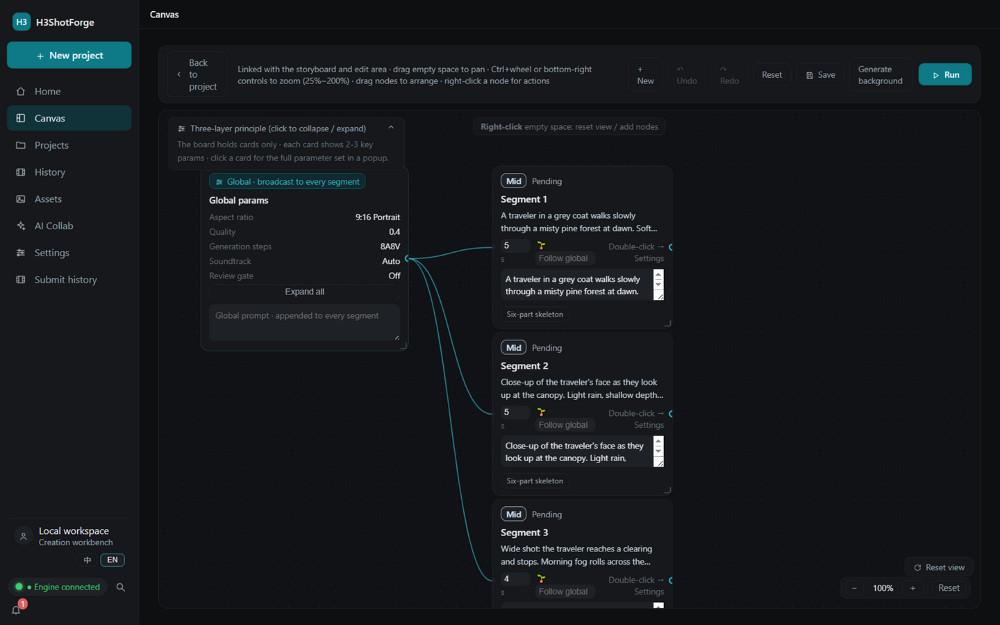

# H3ShotForge · GUI1.4

> A local-first AI storyboard & shot studio — web GUI + ComfyUI plugin, used as a pair.
>
> [中文](README.md) | **English**

H3ShotForge connects the whole loop: write a storyboard → attach references → submit renders → watch the film → edit on a timeline. The front end is a plain static web app (vanilla HTML/CSS/JS, no framework); the back end is a small Python dev server; generation is provided by the `ComfyUI-H3ShotForge` custom node. All project data stays on your machine.

## Screenshots

| Home | Canvas |
|---|---|
|  |  |

| Storyboard & prompts | Prompt preview |
|---|---|
|  |  |

> Screenshots use a demo project and the English UI; no real user data is included.

## Features

- **Projects**: create / open / import / recycle bin; recent projects sorted by last opened.
- **Storyboard & prompts**: edit segment cards in place; per-segment duration, seed, camera fields (angle / shot size / movement / focal length / mood / emotion) and reference images.
- **Asset library**: character / scene / prop cards, three-view / multi-angle, reference audio, drag into a segment to auto-reference with `@N`.
- **Canvas**: wire global params, segments, assets and processing nodes into a graph; pan, zoom, undo / redo.
- **AI collaboration**: optional OpenAI-compatible LLM for rewriting, shot splitting and adopting results back into the storyboard.
- **Submit & render**: preflight → ComfyUI batch → progress / stop / resume; automatic segmentation, concat, upscale and interpolation for long videos.
- **Preview & edit**: full-film preview; timeline editing (split, speed, reverse, freeze, transitions, multi-candidates, audio tracks) and post-processing.
- **History & run records**: inspect outputs per task, rerun, copy as a new project, load parameter snapshots.
- **Bilingual UI**: switch with the `中｜EN` control at the bottom-left (or in Settings); Chinese by default, remembered per browser.

## Structure

```
GUI1.4/                            Web front end + dev server (this repo)
引擎端/V1.14/ComfyUI-H3ShotForge/  ComfyUI custom node (this repo)
```

- **GUI**: `app/` (static pages) + `scripts/devserver.py` (Python standard-library HTTP server for static files, data I/O and engine proxying).
- **Engine**: ComfyUI plugin providing batch rendering, prompt assembly, concat / color matching / post-processing and LLM sessions; listens on `8190` by default.
- The two talk over HTTP. The GUI can browse and edit existing projects offline, but **rendering requires the engine**.

## Requirements

| Item | Requirement |
|---|---|
| OS | Windows 10 / 11 (primary tested environment; Linux / macOS untested) |
| Python | 3.10+ (tested on 3.11) |
| ComfyUI | A working custom-node environment (tested with ComfyUI Desktop / 1.47.x) |
| ffmpeg / ffprobe | Needed for concat, color matching, post-processing and audio tracks; if not on PATH, set `ffprobe_exe` in `h3_config.json` |
| H3 models & workflow templates | **Not bundled**; install them in ComfyUI and point `workflow_dir` at your templates |
| LLM (optional) | AI collaboration needs an OpenAI-compatible endpoint (LM Studio or a hosted API) |

## Installation

### 1. Install the engine

1. Close ComfyUI.
2. Copy the whole `引擎端/V1.14/ComfyUI-H3ShotForge` folder to:

   ```
   <your ComfyUI>/custom_nodes/ComfyUI-H3ShotForge
   ```

3. In that folder, copy `h3_config.json.example` to `h3_config.json` and fill in your machine's paths (at least `workflow_dir`, `input_dir`, `output_dir`; set `ffprobe_exe` if ffprobe is not on PATH).
4. Start ComfyUI and verify the engine is up:

   ```
   http://127.0.0.1:8190/system_stats
   ```

### 2. Start the GUI

1. Copy the `GUI1.4` folder anywhere (it does not need to live next to ComfyUI).
2. Open a terminal in that folder and start the dev server:

   ```bat
   py scripts\devserver.py 8940
   ```

   > If `py` is unavailable, use `python scripts\devserver.py 8940`.

3. Open in your browser:

   ```
   http://127.0.0.1:8940/
   ```

### 3. First-time settings

- **Engine & models → Engine address**: defaults to `http://127.0.0.1:8190`; the **Auto Scan** button probes 8188–8200.
- **Workspace / output / template directories**: set to your local paths; the template directory must contain your H3 workflow JSON files.
- **AI collaboration (optional)**: configure an OpenAI-compatible Base URL / key / model preset in Settings.

## Quick start

1. **New project** → enter a name.
2. **Setup → Params**: aspect ratio, quality, generation steps, language, soundtrack, etc.
3. **Setup → Prompts**: write the storyboard segment by segment; attach reference images / audio when needed.
4. **Assets (optional)**: create character / scene / prop cards; drag into a segment to reference them.
5. **Run project**: preflight → submit → watch progress and outputs in **Submit history**.
6. **Project preview**: watch the full film; open **Edit** for timeline editing, speed, transitions and post-processing.
7. **History**: inspect, rerun, or copy a task as a new project.

## Directory layout

```
GUI1.4/
├─ app/                 Front-end source (index.html / css / js)
├─ scripts/devserver.py Dev server (static + data + engine proxy)
└─ data/                Runtime data (auto-created, not in git)
   ├─ index.json        Project index
   └─ projects/*.json   Project entities

引擎端/V1.14/ComfyUI-H3ShotForge/
├─ __init__.py          Plugin entry & HTTP endpoints
├─ batch_core.py        Batch core
├─ prompt_assembler.py  Prompt assembly
├─ join_engine.py       Concat / transitions / color matching
├─ postfx_engine.py     Upscale / interpolation
├─ h3_config.json.example  Config template
└─ web/                 Plugin's own web UI (optional)
```

## Data & backup

- All project data lives in `GUI1.4/data/` (created on first run).
- Backup: copy the whole `data/` folder; migrate by copying it to the new machine.
- Reset: back up first, then delete `data/` (returns to an empty library).
- `data/` is runtime data — **do not commit it to git** (the repo's `.gitignore` already excludes it).

## FAQ

**The engine shows “disconnected”?**
Check that `http://127.0.0.1:8190/system_stats` opens. Then use **Auto Scan** or enter the engine address in Settings. Restart ComfyUI after changing engine config.

**Port already in use?**
The GUI defaults to 8940 (the engine uses 8190). If 8940 is taken, start with another port (`py scripts\devserver.py 8941`) and update the browser URL.

**ffmpeg errors during concat / post-processing?**
Make sure ffmpeg/ffprobe are installed; if not on PATH, set `ffprobe_exe` to its absolute path in `h3_config.json`, then restart ComfyUI.

**The template dropdown is empty?**
`workflow_dir` is unset or contains no workflow JSON files. Templates are not bundled; provide your own.

**Changes don't show up?**
Static modules are served without strong cache headers. Press **Ctrl+F5** after updates.

**How do I switch to Chinese?**
Use the `中｜EN` control at the bottom-left, or Settings → Interface language. The page reloads and remembers your choice.

**AI collaboration doesn't send?**
Check the LLM preset's Base URL / key / model in Settings. For local LM Studio, use its `/v1` compatible URL.

## Known limitations / not included

- H3 models, CLIP / VAE / LoRA weights, workflow templates and ffmpeg binaries are not bundled.
- The English UI covers the framework and main flows; a few long help texts and **your own data values** (project names, asset names, prompts) stay as entered.
- Windows is the primary tested platform; Linux / macOS untested.
- No built-in accounts / permissions — designed for **single-user local use**. Do not expose it directly to the public internet.
- Output quality depends on the models, workflows and prompts used; review AI output before relying on it.

## License & disclaimer

- **License**: Proprietary, all rights reserved. Contact the author for commercial use, redistribution or collaboration.
- **Disclaimer**: This tool only provides generation and editing capabilities. Users are responsible for generated content and must comply with local laws and platform rules. Do not use it to impersonate others, infringe portrait / copyright rights, or for any illegal purpose. Models and assets remain the property of their respective owners.

## Version

- GUI: 1.4
- Engine: V1.14 (ComfyUI-H3ShotForge)
