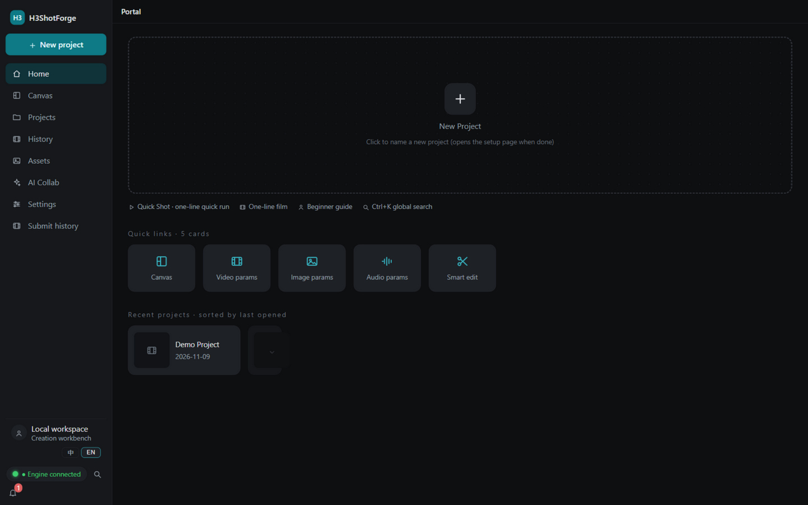
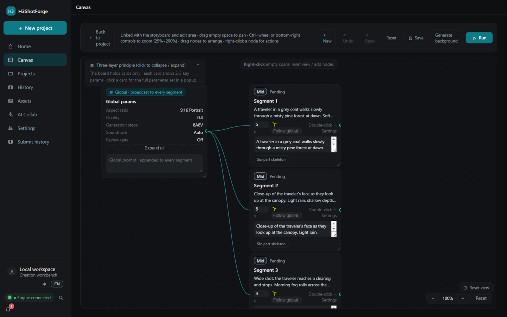
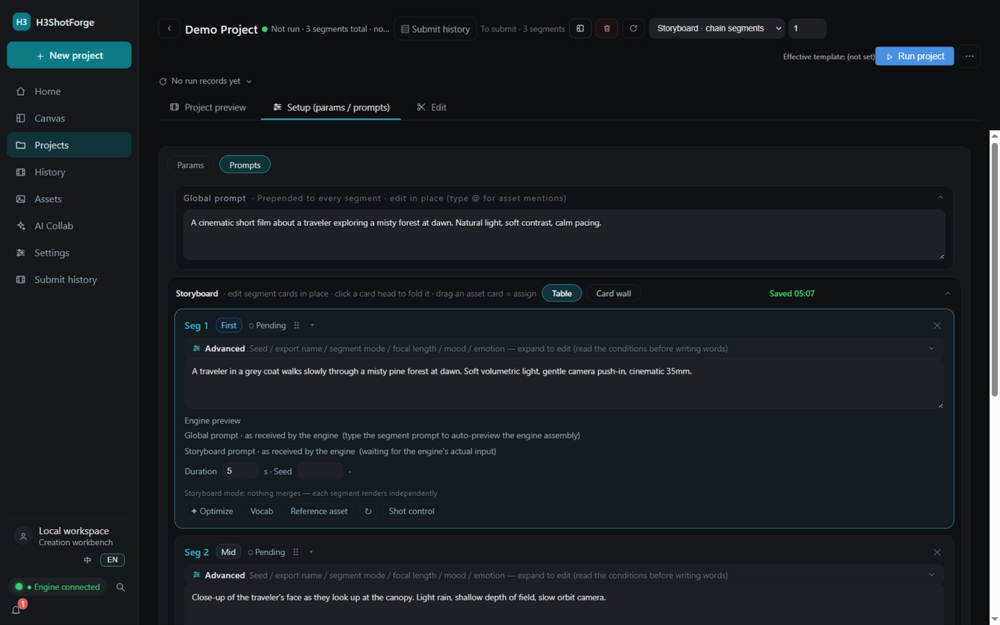
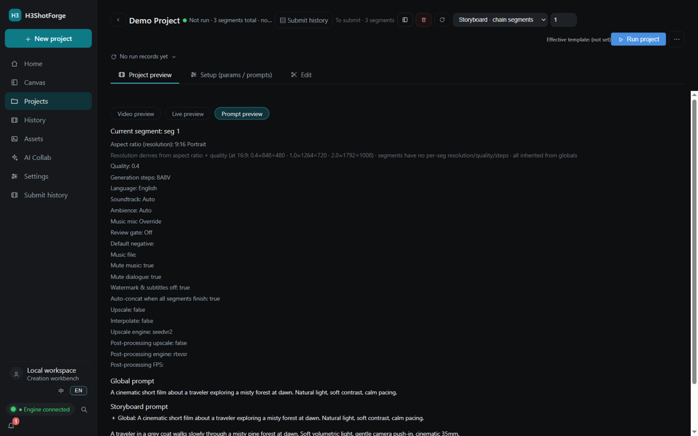
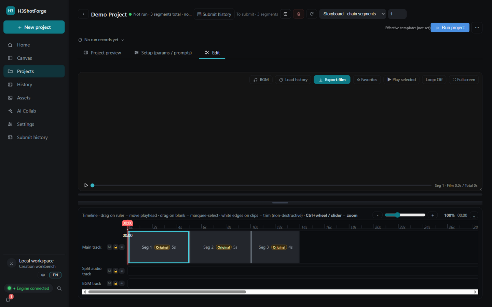

# H3ShotForge · GUI1.4

> 本地运行的 AI 分镜 / 拍戏工作台 —— 网页 GUI + ComfyUI 插件，成套使用。
>
> **中文** | [English](README.en.md)

H3ShotForge 把「写分镜 → 挂参考素材 → 提交渲染 → 看成片 → 时间线剪辑」串成一条本地工作流。前端是一个纯静态网页（原生 HTML/CSS/JS，无框架），后端是一个轻量 Python 开发服务器，生成能力来自 `ComfyUI-H3ShotForge` 这个 ComfyUI 自定义节点。所有项目数据都保存在你自己的电脑上。

## 截图

| 首页 | 创作画布 |
|---|---|
|  |  |

| 分镜与提示词 | 提示词预览 |
|---|---|
|  |  |

> 截图使用演示项目与英文界面，不含任何真实用户数据。

### 时间线剪辑



## 功能

- **项目管理**：新建 / 打开 / 导入 / 回收站；最近项目按访问时间排序。
- **分镜与提示词**：段卡就地编辑，每段可设时长、种子、镜头参数（角度 / 景别 / 运镜 / 焦段 / 氛围 / 情绪）与参考图。
- **资产管理**：角色 / 场景 / 道具卡片，支持三视图、多角度、参考音频、拖入分镜自动 `@N` 引用。
- **创作画布**：把全局参数、段、资产、处理节点连成图，支持拖拽、缩放、撤销 / 重做。
- **AI 协作**：可选接入本地或远程大模型（OpenAI 兼容接口），做分镜改写、智能拆镜、结果采纳回填。
- **提交与渲染**：预检 → 提交 ComfyUI 批处理 → 进度 / 停止 / 续跑；长视频自动分段、拼接、超分、插帧。
- **预览与剪辑**：全片预览、时间线剪辑（分割、变速、倒放、定格、转场、多候选、音轨），加后期。
- **历史与运行记录**：按任务查看产物、重跑、复制为新项目、参数快照与载入。
- **中英双语**：左下角「中｜EN」一键切换，设置页亦可切换；默认中文，按浏览器记忆。

## 组成与架构

```
GUI1.4/                          网页前端 + 开发服务器（本仓库）
引擎端/V1.14/ComfyUI-H3ShotForge/  ComfyUI 自定义节点（本仓库）
```

- **GUI**：`app/`（静态页面）+ `scripts/devserver.py`（Python 标准库 HTTP 服务，负责静态文件、数据读写、引擎转发）。
- **引擎端**：ComfyUI 插件，提供批处理、提示词装配、拼接 / 调色 / 后期、LLM 会话等能力；作为插件随 ComfyUI 启动（不单独监听端口，ComfyUI 默认 `8188`，以你的实际地址为准）。
- 两者通过 HTTP 通信；GUI 可以脱离引擎查看和编辑已有项目，但**生成必须引擎在线**。

## 环境要求

| 项 | 要求 |
|---|---|
| 操作系统 | Windows 10 / 11（当前主要验证环境；Linux / macOS 未验证） |
| Python | 3.10+（验证环境 3.11） |
| ComfyUI | 需含官方 MiniMax H3 节点（核心 v0.30.0+；桌面版用最新版）；本仓库不附带 H3 模型与工作流模板 |
| ffmpeg / ffprobe | 拼接、调色、后期、音轨处理需要；未加入 PATH 时在 `h3_config.json` 里写 `ffprobe_exe` |
| H3 模型与工作流模板 | **不在本仓库内**，需自备并放到 ComfyUI 与 `workflow_dir` |
| LLM（可选） | AI 协作需要 OpenAI 兼容接口（LM Studio / 在线 API 均可） |

## 支持的工作流

引擎按**模板结构 + 文件名**识别模板族：

| 模板族 | 支持 | 说明 |
|---|---|---|
| **ref2v** | ✅ 推荐 | 模板含 `MiniMaxH3ReferenceToVideo`；支持参考图 / 参考视频 / 参考音频（`<Picture N>` / `<Video N>` / `<Audio N>`），可挂 Turbo LoRA。示例：`turboVA+CK/h3_ref2va_8V8A_CK.json` |
| **t2v** | ✅ | 纯文本生成（匿名工作流 / 无 H3 参考节点），适合无参考素材的镜头 |
| i2v / fl2v | ❌ 已废除 | 引擎会拒绝并提示「i2v/fl2v 已废除，请改用 ref2v 模板」 |

- **模板位置**：`h3_config.json` 的 `workflow_dir`；引擎递归扫描该目录下所有 `.json`（跳过名字含「备份」的目录），GUI 的「工作流模板」下拉直接读取。
- **模板要求**：ComfyUI 原生 H3 工作流（ref2v 模板使用官方 `MiniMaxH3ReferenceToVideo`，配合 `MiniMaxH3SigmaShift`、`BasicScheduler` / `KSamplerSelect` / `BasicGuider` 与音视频解码链路），保存为 JSON；引擎会改写提示词、种子、时长、参考素材等输入。`MiniMaxH3ImageToVideo` 的 i2v/fl2v 模板会被拒绝（已废除）。
- **模板不自带**：主工作流 JSON 需自备（见「下载与资源」）。

## 后处理（超分 / 插帧）

| 能力 | 引擎选项 | 模板 | 节点包 / 获取 |
|---|---|---|---|
| 超分 | SeedVR2（默认） | `h3_postfx_upscale.json`（自带） | [ComfyUI-SeedVR2_VideoUpscaler](https://github.com/numz/ComfyUI-SeedVR2_VideoUpscaler)（SeedVR2 官方 ComfyUI 版；模型见其 README） |
| 超分 | RTX VSR | `h3_postfx_upscale_rtx.json`（自带） | [Comfy-Org/Nvidia_RTX_Nodes_ComfyUI](https://github.com/Comfy-Org/Nvidia_RTX_Nodes_ComfyUI)（兼容替代：[ComfyUI-NVIDIA-RTX-VSR-Pro](https://github.com/whmc76/ComfyUI-NVIDIA-RTX-VSR-Pro)）；需 NVIDIA RTX 显卡 + 驱动 + `nvidia-vfx` |
| 插帧 | RIFE | `h3_postfx_interp.json`（自带） | [ComfyUI-Frame-Interpolation](https://github.com/Fannovel16/ComfyUI-Frame-Interpolation)（按 README 运行 `install.bat`） |

- 三个后处理模板随插件提供（优先从 `docs/证据-1.14b/templates/` 加载；RTX 模板另有一份在插件根目录），无需自备。
- 在「Setup → 参数 → 后处理」组开启；RTX VSR 仅支持 RTX 显卡；SeedVR2 显存占用较高，长视频会自动分段。

## 下载与资源

| 用途 | 地址 | 备注 |
|---|---|---|
| ComfyUI 本体 | https://github.com/comfyanonymous/ComfyUI | 需含官方 MiniMax H3 节点（核心 v0.30.0+；桌面版用最新版） |
| H3 模型权重（官方） | https://huggingface.co/MiniMaxAI/MiniMax-H3 | MiniMax 官方发布 |
| H3 模型（ComfyUI 整理版） | https://huggingface.co/Comfy-Org/MiniMax-H3 | 路径/命名更贴合 ComfyUI |
| H3 模型 + 示例工作流（第三方资源包） | https://comfyit.cn/article/506 | AIMixer 导演台 README 推荐；第三方站点，请自行确认授权与版本 |
| H3 导演台（可选，非本引擎） | https://github.com/AIMixer/ComfyUI_MiniMaxH3_Director | 可参考其工作流与资源说明 |
| ffmpeg / ffprobe | https://ffmpeg.org/download.html | 拼接、后期、音轨必需 |
| SeedVR2 / RTX VSR / RIFE | 见上一节 | 后处理节点包 |

> 本仓库不附带模型权重、主工作流模板与 ffmpeg 二进制。模型放 `ComfyUI/models/`，工作流 JSON 放 `workflow_dir`。

## 安装

### 1. 安装引擎端

1. 关闭 ComfyUI。
2. 把 `引擎端/V1.14/ComfyUI-H3ShotForge` 整个目录复制到：

   ```
   <你的 ComfyUI>/custom_nodes/ComfyUI-H3ShotForge
   ```

3. 进入该目录，把 `h3_config.json.example` 复制为 `h3_config.json`，按本机情况填写（至少 `workflow_dir`、`input_dir`、`output_dir`；ffprobe 不在 PATH 时填 `ffprobe_exe`）。
4. 启动 ComfyUI，确认引擎在线：

   ```
   http://127.0.0.1:8188/system_stats
   ```

   > ComfyUI 默认端口是 8188；若你的 ComfyUI 跑在 8190 等端口，换成实际地址即可。

### 2. 启动 GUI

1. 把 `GUI1.4` 目录复制到任意位置（不需要和 ComfyUI 放在一起）。
2. 在该目录打开终端，启动开发服务器：

   ```bat
   py scripts\devserver.py 8940
   ```

   > 若本机没有 `py` 命令，改用 `python scripts\devserver.py 8940`。

3. 浏览器打开：

   ```
   http://127.0.0.1:8940/
   ```

### 3. 首次配置（设置页）

- **引擎与模型 → 引擎地址**：默认 `http://127.0.0.1:8190`（按你的 ComfyUI 实际端口修改；ComfyUI 默认 8188），可点「自动扫描」探测 8188–8200。
- **工作区 / 输出目录 / 模板目录**：按本机实际路径填写；模板目录需指向你的 H3 工作流 JSON 所在目录。
- **AI 协作（可选）**：在设置页配置 OpenAI 兼容的 Base URL / Key / 模型预设。

## 快速开始

1. **新建项目** → 填项目名。
2. **Setup → Params**：设定比例、质量、生成步数、语言、配乐等全局参数。
3. **Setup → Prompts**：逐段写分镜提示词；需要时挂参考图 / 参考音频。
4. **Assets（可选）**：建角色 / 场景 / 道具卡，拖入分镜即可自动引用。
5. **Run project**：预检 → 提交 → 在「Submit history」看进度与产物。
6. **Project preview**：看全片；需要时进 **Edit** 时间线做剪辑、变速、转场、加后期。
7. **History**：按任务回看 / 重跑 / 复制为新项目。

## 目录结构

```
GUI1.4/
├─ app/                 前端源码（index.html / css / js）
├─ scripts/devserver.py 开发服务器（静态 + 数据 + 引擎转发）
└─ data/                运行时数据（自动创建，不入 git）
   ├─ index.json        项目总表
   └─ projects/*.json   各项目实体

引擎端/V1.14/ComfyUI-H3ShotForge/
├─ __init__.py          插件入口与 HTTP 端点
├─ batch_core.py        批处理核心
├─ prompt_assembler.py  提示词装配
├─ join_engine.py       拼接 / 转场 / 调色
├─ postfx_engine.py     超分 / 插帧
├─ h3_config.json.example 配置模板
└─ web/                 插件自带网页 UI（可选）
```

## 数据与备份

- 所有项目数据在 `GUI1.4/data/`（首次启动自动创建）。
- 备份：直接复制整个 `data/` 目录即可；迁移到另一台电脑同样复制过去。
- 重置：先备份，再删除 `data/`（会回到空库）。
- `data/` 属运行时数据，**不要提交到 git**（仓库根 `.gitignore` 已排除）。

## 常见问题

**引擎显示「未连接」？**
先确认你的 ComfyUI 地址能打开（默认 `http://127.0.0.1:8188/system_stats`；若用 8190 则替换）；再在设置页点「自动扫描」或手填引擎地址。修改引擎配置后需重启 ComfyUI。

**端口被占用？**
GUI 默认 8940；引擎端口以 ComfyUI 为准（默认 8188）。若 8940 被占用，换一个端口：`py scripts\devserver.py 8941`，浏览器地址同步改。

**拼接 / 后期报 ffmpeg 错误？**
确认 ffmpeg/ffprobe 已安装；不在 PATH 时在 `h3_config.json` 填 `ffprobe_exe` 的绝对路径，然后重启 ComfyUI。

**模板下拉是空的？**
`h3_config.json` 的 `workflow_dir` 没配或目录里没有工作流 JSON。模板需自备（本仓库不含）。

**界面改了没生效？**
网页静态模块没有强缓存头，验收 / 更新后按 **Ctrl+F5** 强制刷新。

**怎么切英文？**
左下角「中｜EN」一键切换；也可在设置页「界面语言」切换。切换后整页刷新并记忆。

**AI 协作发不出消息？**
设置页检查 LLM 预设的 Base URL / Key / 模型名；本地 LM Studio 需填 `/v1` 兼容地址。

## 已知限制 / 未包含

- 不含 H3 模型、CLIP / VAE / LoRA 权重、工作流模板与 ffmpeg 二进制，需自行准备。
- **仅支持 ref2v / t2v 模板；i2v / fl2v 已废除**（引擎会拒绝）。
- **RTX VSR 需要 NVIDIA RTX 显卡与驱动**；SeedVR2 对显存要求较高，长视频会自动分段处理。
- 英文界面覆盖框架与常用路径；少量长帮助文本与**你输入的数据值**（项目名、资产名、提示词）保持原样。
- 目前以 Windows 为主要验证环境；Linux / macOS 未验证。
- 无内置账号 / 权限系统，设计为**本机单用户**使用；请勿直接暴露到公网。
- 生成质量取决于所用模型、工作流与提示词；AI 输出需人工审核后再使用。

## 许可与免责

- **许可**：源代码可见，采用 **PolyForm Noncommercial License 1.0.0**（见 [LICENSE](LICENSE)）。**个人自用、学习、研究、测试等非商业用途免费**；**任何商业用途（含公司内部生产使用、对外服务、集成或转售）必须事先取得作者的商业授权**。商用授权与合请联系作者。
- **免责**：本工具仅提供生成与编辑能力。使用者需对生成内容负责，遵守所在地法律法规与平台规则；不得用于伪造他人身份、侵犯肖像权 / 著作权或其他违法用途。模型与素材的版权归各自权利人所有。

## 版本

- GUI：1.4
- 引擎端：V1.14（ComfyUI-H3ShotForge）
